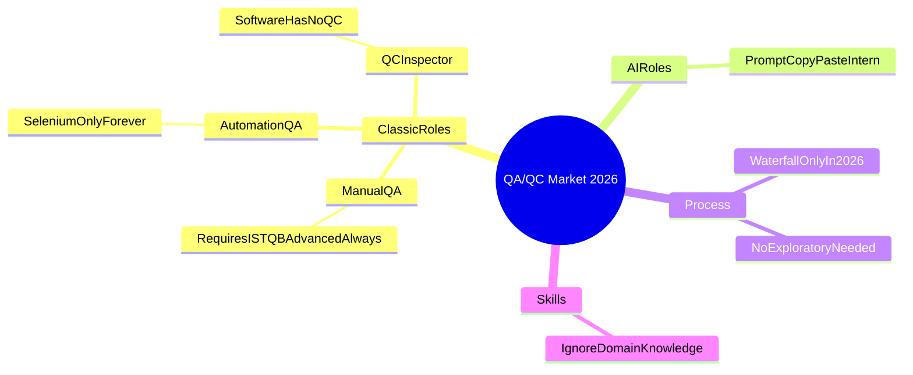

# QA/QC Role Mindmap — AI DRAFT (có lỗi cố ý để G9.1)

> Artifact này mô phỏng output AI trước khi bạn sửa. Đã gắn **3 lỗi** (xem cuối file).

## 3 mistakes in this AI draft

1. **`RequiresISTQBAdvancedAlways`** — Sai: ISTQB Advanced không bắt buộc cho mọi Manual QA junior; Foundation (hoặc tương đương kinh nghiệm) mới phổ biến.
2. **`SoftwareHasNoQC` / SeleniumOnlyForever / WaterfallOnlyIn2026** — Sai: Software vẫn có QC/quality control activities; 2026 dùng nhiều tool (Playwright, Cypress…); Agile/DevOps phổ biến hơn Waterfall-only.
3. **`NoExploratoryNeeded` + AI role chỉ là PromptCopyPasteIntern** — Sai: Exploratory testing vẫn quan trọng; role AI-augmented QA/SDET/LLM eval engineer rộng hơn copy-paste prompt.

Corrected mindmap: [`qa_qc_mindmap_corrected.md`](qa_qc_mindmap_corrected.md)
