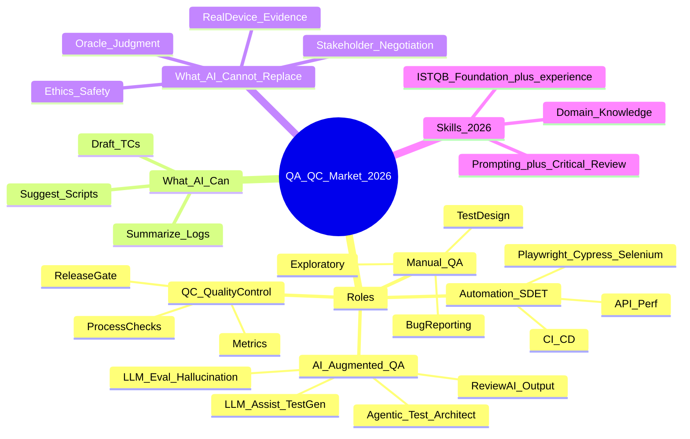

# QA/QC Role Mindmap — CORRECTED (student fix)

## Fixes vs AI draft

| #   | AI mistake                                        | Correction                                                                   |
| --- | ------------------------------------------------- | ---------------------------------------------------------------------------- |
| 1   | Mọi Manual QA phải ISTQB Advanced                 | Foundation / kinh nghiệm thực tế là đủ phổ biến; Advanced là tùy career path |
| 2   | Software không có QC; chỉ Selenium; chỉ Waterfall | Có QC/release gate; đa tool; Agile/DevOps                                    |
| 3   | Bỏ exploratory; AI role = copy prompt             | Giữ exploratory; AI role gồm review + LLM eval + agentic QE                  |
